<div align="center">

# Saily für Einsteiger

[中文](./README.md) · [English](./README.en.md) · [日本語](./README.ja.md) · [한국어](./README.ko.md) · [Español](./README.es.md) · [Português](./README.pt.md) · [Français](./README.fr.md) · **Deutsch** · [Русский](./README.ru.md) · [العربية](./README.ar.md)

### Mehr aus Saily herausholen: online, sobald du landest

Saily ist eine Reise-eSIM. Du installierst sie vor der Abreise auf deinem Handy, schaltest nach der Landung die Daten ein und bist online. Außerdem kann Saily dir eine US-Telefonnummer geben.<br>Diese Anleitung folgt dem offiziellen Hilfe-Center von Saily und macht daraus drei kurze Lektionen, sodass auch jemand mitkommt, der noch nie eine eSIM benutzt hat.

**[Mit Lektion 1 anfangen →](https://saily.xiaoxiaodong.ai/de/start/1-check-phone/)**　·　**[Schon dabei? Die vollständige Anleitung (Englisch) →](https://saily.xiaoxiaodong.ai/en/guide/0-what/)**

<sub>Inoffiziell · kostenlos · Open Source · 10 Sprachen</sub>

</div>

<p align="center">
  
</p>

## Das kennst du wahrscheinlich

Das Flugzeug landet, und in deinem Handy steckt noch deine Haupt-SIM. Entweder hast du keine Daten, oder Roaming ist an und dir graut vor der Rechnung. Also suchst du das Flughafen-WLAN oder stellst dich für eine lokale SIM-Karte an, dann suchst du eine Nadel und passt auf, dass du deine eigene Karte nicht verlierst.

Eine eSIM steckt diese Karte ins Innere des Handys. Installier Saily vor der Abreise zu Hause im WLAN, ohne etwas herauszunehmen. Deine Hauptnummer bleibt, und Anrufe darauf solltest du weiter annehmen können (dein Heimanbieter kann dafür Roaming berechnen, also frag vorher nach). Sobald du gelandet bist, laufen deine Daten über Saily.

<p align="center">
  
</p>

## Drei Lektionen, eine Sache nach der anderen

Du musst vorher nicht wissen, was ein APN oder Roaming ist. Jede Lektion macht genau eine Sache, und du gehst mit etwas Neuem raus.

<p align="center">
  
</p>

1. **[Prüfen, ob dein Handy eSIM kann](https://saily.xiaoxiaodong.ai/de/start/1-check-phone/)**: Ein Blick in die Einstellungen deines Handys verrät es dir. Viele Modelle, die auf dem chinesischen Festland, in Hongkong, Macau, Taiwan und Korea verkauft werden, unterstützen es nicht, also prüf das vor dem Kauf.
2. **[Ein Datenpaket kaufen und vor der Abreise installieren](https://saily.xiaoxiaodong.ai/de/start/2-data-plan/)**: Installier es zu Hause im WLAN, die Tage des Pakets zählen erst ab deinem Reiseziel. Saily warnt selbst, dass die App in manchen Ländern nicht erreichbar sein kann, also installier vorher.
3. **[Landen, Daten einschalten, online sein](https://saily.xiaoxiaodong.ai/de/start/3-land/)**: Wähl Saily für Daten, und schalte Datenroaming nur für die Saily-Leitung ein.

## Keine eSIM im Handy? Es gibt trotzdem einen Weg

Für Handys ohne eSIM ist der offizielle Weg von Saily eine physische eSIM.me-Karte im SIM-Steckplatz, dazu ein QR-Code zur Installation vom Saily-Support. Nutzer auf X haben auch Wege mit anderen physischen Karten geteilt. Die Doku von Saily deckt diese nicht ab, und die Anleitung kennzeichnet sie deutlich.

<p align="center">
  
</p>

Details in [Schritt 6 der Anleitung](https://saily.xiaoxiaodong.ai/en/guide/6-no-esim/) (auf Englisch).

## Eine US-Telefonnummer gefällig?

Saily verkauft auch eine US-Nummer mit +1, mit der du telefonieren und SMS sowie Bestätigungscodes empfangen kannst. Vorher bestätigst du deine Identität; bei Dokumenten aus China brauchst du sowohl einen Reisepass als auch einen Personalausweis. Saily sagt offen, dass die Nummer über das Netz eines VoIP-Anbieters läuft: Die meisten Dienste schicken problemlos Codes dorthin, aber manche Banken, Finanz- und Zahlungs-Apps akzeptieren sie nicht.

Wie du sie bekommst, behältst und was du tust, wenn ein Code nicht ankommt: [Schritt 5 der Anleitung](https://saily.xiaoxiaodong.ai/en/guide/5-phone-number/) und die [How-tos zur Telefonnummer](https://saily.xiaoxiaodong.ai/en/howto/) (auf Englisch).

## Schon dabei?

Diese Seiten sind auf Englisch.

- **[Die vollständige Anleitung](https://saily.xiaoxiaodong.ai/en/guide/0-what/)**: acht Schritte zu Paketwahl, Installation, Problemlösung im Ausland, Verbrauch und Nachkaufen, der US-Nummer, Handys ohne eSIM und Extras wie dem Werbeblocker und geteilten Paketen.
- **[How-to](https://saily.xiaoxiaodong.ai/en/howto/)**: 14 konkrete Aufgaben, von der Reise durch mehrere Länder, dem Hotspot und deiner Hauptnummer neben Saily bis zu Handywechsel, fehlendem Signal und Erstattungen.
- **[Wiki](https://saily.xiaoxiaodong.ai/en/wiki/)** und **[häufige Fragen](https://saily.xiaoxiaodong.ai/en/faq/)**: Begriffe wie APN, ICCID und Datenroaming, und die Fragen, die man vor einer Reise stellt.

## Woher die Inhalte kommen

Jede Funktion, jeder Preis und jeder Schritt ist mit dem [offiziellen Hilfe-Center von Saily](https://support.saily.com/hc/de) abgeglichen und auf der Seite verlinkt; wo sich das chinesische und das englische Hilfe-Center widersprechen, gilt das englische, und die Seite sagt das dazu. Erfahrungen von X werden nur als das zitiert, was jemand ausprobiert hat, mit Link.

Diese Anleitung enthält keine Rabatt- oder Empfehlungscodes, bringt keine Preistricks und keine Wege um Netzsperren herum bei und stellt die US-Nummer nicht als Mittel dar, sich als Einwohner der USA auszugeben.

Das ist eine inoffizielle Anleitung ohne Verbindung zu Saily oder Nord Security, und sie spricht nicht für sie. Saily ist eine Marke ihres Inhabers. Funktionen und Preise ändern sich, deshalb sind das offizielle Hilfe-Center und die App maßgeblich.

## Lokal starten

```bash
npm install
npm run dev        # http://localhost:4440
npm run build      # Ausgabe in dist/
```

Schreibregeln, Quellen und das Skript, das das offizielle Hilfe-Center synchronisiert, stehen in [docs/MAINTAINING.md](docs/MAINTAINING.md) (auf Chinesisch). Das Grundgerüst der Seite stammt aus der [Grok-Bot-Anleitung für Einsteiger](https://github.com/nevertoday/xxd-grokbot), mit dem Xiaoxiaodong UI Kit. Code und Texte stehen unter der MIT-Lizenz; siehe [LICENSE](LICENSE). `public/xxd/` ist ein Build des Xiaoxiaodong UI Kit und fällt nicht unter die MIT-Lizenz; siehe `public/xxd/LICENSE`.
