<div align="center">

# Saily 新手教程

**中文** · [English](./README.en.md)

### 如何爽用 Saily：出国落地就有网

Saily 是一张旅行用的 eSIM，出发前在手机里装好，落地打开数据就能上网，还能顺便拿一个美国号码。<br>这个教程对照 Saily 官方帮助中心，把它讲成三节课，第一次用 eSIM 也能跟着做完。

**[从第 1 课开始 →](https://saily.xiaoxiaodong.ai/start/1-check-phone/)**　·　**[已经在用了，看完整教程 →](https://saily.xiaoxiaodong.ai/guide/0-what/)**

<sub>非官方 · 免费 · 开源 · 中文和英文</sub>

</div>

<p align="center">
  
</p>

## 你可能经历过

飞机落地，手机还是国内的卡：要么没网，要么开着漫游心里发慌。于是在机场找 Wi-Fi、排队买当地的卡，换卡时还得找针、怕把原来的卡弄丢。

eSIM 就是把这张卡装进手机里。出发前在家里连着 Wi-Fi 装好 Saily，不用拔卡，国内的号码照常接电话、收短信；落地以后，上网走 Saily 这条线。

<p align="center">
  
</p>

## 三节课，跟着做就会

不用先懂什么是 APN、什么是漫游。一节课只做一件事，做完你手里就多一样东西。

<p align="center">
  
</p>

1. **[先看你的手机能不能用 eSIM](https://saily.xiaoxiaodong.ai/start/1-check-phone/)**：在手机设置里一看就知道。很多在中国大陆、香港、澳门、台湾和韩国卖的机型不支持，先确认再买。
2. **[买一个流量套餐，出发前装好](https://saily.xiaoxiaodong.ai/start/2-data-plan/)**：在家连着 Wi-Fi 装好，套餐到了目的地才开始算天数。Saily 官方也提醒，在有的国家 App 可能打不开，所以要提前装。
3. **[落地，打开数据就能用](https://saily.xiaoxiaodong.ai/start/3-land/)**：上网选 Saily，数据漫游只给 Saily 这条线开。

## 手机不支持 eSIM，也有办法

国行 iPhone 这类不支持 eSIM 的手机，Saily 官方的办法是买一张 eSIM.me 的实体卡插进卡槽，再找 Saily 客服要安装二维码。网友在 X 上还分享过用其他实体卡的做法，Saily 的文档没写到，教程里会标清楚。

<p align="center">
  
</p>

详细的看[完整教程第 6 步](https://saily.xiaoxiaodong.ai/guide/6-no-esim/)。

## 想要一个美国号码？

Saily 另外卖一个美国 +1 号码，能打电话、收短信和验证码。开通前要做实名认证；中国签发的证件，护照和身份证两样都要。官方也说得很直白：这个号码走的是网络电话（VoIP）线路，大多数服务能正常发验证码，但有些银行、金融和支付应用不收。

怎么开、怎么留住、收不到验证码怎么办，见[完整教程第 5 步](https://saily.xiaoxiaodong.ai/guide/5-phone-number/)和[电话号码的几篇 How-to](https://saily.xiaoxiaodong.ai/howto/)。

## 已经在用了？

- **[完整教程](https://saily.xiaoxiaodong.ai/guide/0-what/)**：8 步，选套餐、装 eSIM、落地排错、用量和加购、美国号码、没有 eSIM 的手机，还有广告拦截、共享套餐这些附加功能。
- **[How-to](https://saily.xiaoxiaodong.ai/howto/)**：14 篇具体的事，一趟去好几个国家、开热点、国内号码和 Saily 一起用、换手机、没信号、退款……
- **[Wiki](https://saily.xiaoxiaodong.ai/wiki/)** 和 **[常见问题](https://saily.xiaoxiaodong.ai/faq/)**：APN、ICCID、数据漫游这些词，和出发前最常问的事。

## 这个教程从哪来

功能、价格和步骤，每一条都对照过 [Saily 官方帮助中心](https://support.saily.com/hc/zh-cn)，页面里附原文链接；中英文帮助中心说法不一样的地方，以英文版为准并注明。网友在 X 上分享的经验只当作「有人这样试过」来引用，标明出处。

本站不放优惠码和推荐码，不教钻价格漏洞，不教绕开网络限制，也不把美国号码说成能冒充美国居民的工具。

这是一个非官方的学习站，和 Saily、Nord Security 都没有关系，也不代表它们的说法。Saily 是其所有者的商标。功能和价格会变，以官方帮助中心和 App 里显示的为准。

## 本地运行

```bash
npm install
npm run dev        # http://localhost:4440
npm run build      # 输出到 dist/
```

写作规矩、资料来源和同步官方帮助中心的脚本，见 [docs/MAINTAINING.md](docs/MAINTAINING.md)。网站骨架沿用 [Grok Bot 新手教程](https://github.com/nevertoday/xxd-grokbot)，界面用小小东 UI Kit。代码和文字用 MIT 许可，见 [LICENSE](LICENSE)；`public/xxd/` 是小小东 UI Kit 的构建产物，不在 MIT 范围内，见 `public/xxd/LICENSE`。
