<div align="center">

# Saily para iniciantes

[中文](./README.md) · [English](./README.en.md) · [日本語](./README.ja.md) · [한국어](./README.ko.md) · [Español](./README.es.md) · **Português** · [Français](./README.fr.md) · [Deutsch](./README.de.md) · [Русский](./README.ru.md) · [العربية](./README.ar.md)

### Aproveite a Saily ao máximo: internet assim que o avião pousar

A Saily é um eSIM de viagem. Você instala no celular antes de viajar, liga os dados quando pousa e já está na internet. Ela também pode te dar um número de telefone dos EUA.<br>Este guia segue a Central de Ajuda oficial da Saily e transforma tudo em três lições curtas, para que até quem nunca usou um eSIM consiga acompanhar.

**[Comece pela lição 1 →](https://saily.xiaoxiaodong.ai/pt/start/1-check-phone/)**　·　**[Já usa? O guia completo (em inglês) →](https://saily.xiaoxiaodong.ai/en/guide/0-what/)**

<sub>Não oficial · grátis · código aberto · 10 idiomas</sub>

</div>

<p align="center">
  
</p>

## Você provavelmente já passou por isso

O avião pousa e o seu celular continua com o chip de sempre. Ou você está sem dados, ou o roaming está ligado e você fica preocupado com a conta. Aí você corre atrás do Wi-Fi do aeroporto ou pega fila para comprar um chip local, depois procura um clipe e tenta não perder o seu próprio chip.

Um eSIM coloca esse chip dentro do celular. Você instala a Saily em casa, pelo Wi-Fi, antes de viajar, sem tirar nada do lugar. O seu número de sempre continua, e você deve continuar recebendo ligações nele (a sua operadora pode cobrar roaming por elas, então pergunte antes de viajar). Quando você pousa, os seus dados passam pela Saily.

<p align="center">
  
</p>

## Três lições, uma coisa de cada vez

Você não precisa saber antes o que é um APN ou roaming. Cada lição faz uma coisa só, e você sai de cada uma com algo novo resolvido.

<p align="center">
  
</p>

1. **[Confira se o seu celular funciona com eSIM](https://saily.xiaoxiaodong.ai/pt/start/1-check-phone/)**: uma olhada nos ajustes do celular já responde. Muitos modelos vendidos na China continental, em Hong Kong, Macau, Taiwan e na Coreia não são compatíveis, então confira antes de comprar.
2. **[Compre um plano de dados e instale antes de viajar](https://saily.xiaoxiaodong.ai/pt/start/2-data-plan/)**: instale em casa, pelo Wi-Fi, porque os dias do plano só começam a contar no destino. A própria Saily avisa que em alguns países o app pode ficar inacessível, então instale com antecedência.
3. **[Pousou, ligou os dados, está na internet](https://saily.xiaoxiaodong.ai/pt/start/3-land/)**: escolha a Saily para os dados e ligue o roaming de dados só na linha da Saily.

## Seu celular não tem eSIM? Ainda tem um jeito

Para celulares sem eSIM, o caminho oficial da Saily é um cartão físico eSIM.me na entrada do chip, mais um código QR de instalação que o suporte da Saily envia. Usuários no X também compartilharam formas de usar outros cartões físicos. A documentação da Saily não cobre esses métodos, e o guia deixa isso claro.

<p align="center">
  
</p>

Os detalhes estão no [passo 6 do guia](https://saily.xiaoxiaodong.ai/en/guide/6-no-esim/) (em inglês).

## Quer um número de telefone dos EUA?

A Saily também vende um número +1 dos EUA que faz ligações e recebe SMS e códigos de verificação. Primeiro você verifica a sua identidade; com documentos emitidos na China, é preciso ter o passaporte e também a carteira de identidade nacional. A Saily deixa claro que o número funciona numa rede de operadora VoIP: a maioria dos serviços envia códigos para ele sem problema, mas alguns bancos e apps financeiros e de pagamento não aceitam esse número.

Como conseguir, como manter e o que fazer quando um código não chega: o [passo 5 do guia](https://saily.xiaoxiaodong.ai/en/guide/5-phone-number/) e os [how-tos sobre o número de telefone](https://saily.xiaoxiaodong.ai/en/howto/) (em inglês).

## Já usa?

Estas páginas estão em inglês:

- **[O guia completo](https://saily.xiaoxiaodong.ai/en/guide/0-what/)**: oito passos sobre como escolher um plano, instalar, resolver problemas no exterior, consumo e recargas, o número dos EUA, celulares sem eSIM e extras como o bloqueador de anúncios e os planos compartilhados.
- **[How-to](https://saily.xiaoxiaodong.ai/en/howto/)**: 14 tarefas específicas, de uma viagem por vários países, um hotspot e usar o seu número de sempre junto com a Saily, até trocar de celular, ficar sem sinal e pedir reembolso.
- **[Wiki](https://saily.xiaoxiaodong.ai/en/wiki/)** e **[perguntas frequentes](https://saily.xiaoxiaodong.ai/en/faq/)**: palavras como APN, ICCID e roaming de dados, e as perguntas que as pessoas fazem antes de uma viagem.

## De onde vem o conteúdo

Cada recurso, preço e passo é conferido na [Central de Ajuda oficial da Saily](https://support.saily.com/hc/pt-br), com o link na própria página; quando a Central de Ajuda em chinês e a em inglês não batem, vale a em inglês, e a página avisa. Experiências compartilhadas no X só aparecem como algo que alguém testou, com o link.

Este guia não traz códigos promocionais nem códigos de indicação de outras pessoas; a única exceção é a página [Quick number](https://saily.xiaoxiaodong.ai/en/quick-number/) (em inglês), com o código de indicação do autor e o aviso de que o autor recebe crédito por ele. Também não ensina truques com preços nem formas de contornar restrições de rede, e não apresenta o número dos EUA como um jeito de se passar por morador dos EUA.

Este é um guia não oficial, sem nenhuma relação com a Saily ou com a Nord Security, e não fala em nome delas. Saily é uma marca do seu proprietário. Recursos e preços mudam, então a referência são a Central de Ajuda oficial e o app.

## Rodar localmente

```bash
npm install
npm run dev        # http://localhost:4440
npm run build      # gera em dist/
```

As regras de escrita, as fontes e o script que sincroniza a Central de Ajuda oficial estão em [docs/MAINTAINING.md](docs/MAINTAINING.md) (em chinês). A estrutura do site vem do [guia Grok Bot para iniciantes](https://github.com/nevertoday/xxd-grokbot), com o Xiaoxiaodong UI Kit. O código e os textos têm licença MIT; veja [LICENSE](LICENSE). `public/xxd/` é uma build do Xiaoxiaodong UI Kit e não é coberto pela licença MIT; veja `public/xxd/LICENSE`.
