<div align="center">

# Saily для начинающих

[中文](./README.md) · [English](./README.en.md) · [日本語](./README.ja.md) · [한국어](./README.ko.md) · [Español](./README.es.md) · [Português](./README.pt.md) · [Français](./README.fr.md) · [Deutsch](./README.de.md) · **Русский** · [العربية](./README.ar.md)

### Как взять от Saily всё: интернет сразу после посадки

Saily продаёт eSIM для поездок. Установите её на телефон до отъезда, после посадки включите интернет, и вы в сети. Ещё через Saily можно получить американский номер телефона.<br>Это руководство идёт по официальному справочному центру Saily и превращает его в три коротких урока, так что разобраться сможет даже тот, кто впервые слышит про eSIM.

**[Начать с урока 1 →](https://saily.xiaoxiaodong.ai/ru/start/1-check-phone/)**　·　**[Уже пользуетесь? Полное руководство (на английском) →](https://saily.xiaoxiaodong.ai/en/guide/0-what/)**

<sub>Неофициально · бесплатно · открытый код · 10 языков</sub>

</div>

<p align="center">
  
</p>

## Наверное, вам это знакомо

Самолёт сел, а в телефоне всё ещё ваша основная SIM-карта. Либо интернета нет совсем, либо включён роуминг, и вы с тревогой думаете о счёте. И вот вы ищете Wi-Fi в аэропорту или стоите в очереди за местной SIM-картой, а потом ищете скрепку и стараетесь не потерять свою карточку.

eSIM прячет эту карточку внутрь телефона. Установите Saily дома через Wi-Fi ещё до отъезда, ничего не вынимая. Ваш номер остаётся при вас, и звонки на него вы, скорее всего, по-прежнему сможете принимать (оператор может брать за них плату за роуминг, так что уточните у него заранее). А после посадки интернет пойдёт через Saily.

<p align="center">
  
</p>

## Три урока, по одному делу за раз

Заранее знать, что такое APN или роуминг, не нужно. Каждый урок делает одно дело, и после каждого у вас появляется что-то новое.

<p align="center">
  
</p>

1. **[Проверьте, работает ли ваш телефон с eSIM](https://saily.xiaoxiaodong.ai/ru/start/1-check-phone/)**: достаточно один раз заглянуть в настройки телефона. Многие модели, которые продаются в материковом Китае, Гонконге, Макао, на Тайване и в Корее, eSIM не поддерживают, так что проверьте до покупки.
2. **[Купите тариф и установите его до отъезда](https://saily.xiaoxiaodong.ai/ru/start/2-data-plan/)**: установите дома через Wi-Fi, а дни тарифа начнут считаться только на месте. Saily сама предупреждает, что в некоторых странах приложение может не открываться, так что ставьте заранее.
3. **[Приземлились, включили интернет, вы в сети](https://saily.xiaoxiaodong.ai/ru/start/3-land/)**: выберите Saily для интернета и включите роуминг данных только для линии Saily.

## В телефоне нет eSIM? Выход всё равно есть

Для телефонов без eSIM официальный путь Saily такой: физическая карта eSIM.me в слоте для SIM-карты плюс QR-код для установки, который выдаёт поддержка Saily. Пользователи X рассказывали и о том, как пользоваться другими физическими картами. В документации Saily об этом ничего нет, и руководство это прямо отмечает.

<p align="center">
  
</p>

Подробности в [шаге 6 руководства](https://saily.xiaoxiaodong.ai/en/guide/6-no-esim/) (на английском).

## Нужен американский номер?

Ещё Saily продаёт американский номер +1, с которого можно звонить и на который приходят SMS и коды подтверждения. Сначала нужно подтвердить личность; для документов, выданных в Китае, нужны и паспорт, и национальное удостоверение личности. Saily честно пишет, что номер работает через сеть VoIP-оператора: большинство сервисов присылают на него коды без проблем, но некоторые банки, финансовые и платёжные приложения его не принимают.

Как его получить, как сохранить и что делать, если код не пришёл: [шаг 5 руководства](https://saily.xiaoxiaodong.ai/en/guide/5-phone-number/) и [инструкции про номер телефона](https://saily.xiaoxiaodong.ai/en/howto/) (на английском).

## Уже пользуетесь?

- **[Полное руководство](https://saily.xiaoxiaodong.ai/en/guide/0-what/)** (на английском): восемь шагов о выборе тарифа, установке, решении проблем за границей, расходе и пополнении, американском номере, телефонах без eSIM и дополнительных функциях вроде блокировщика рекламы и общих тарифов.
- **[How-to](https://saily.xiaoxiaodong.ai/en/howto/)** (на английском): 14 конкретных задач, от поездки по нескольким странам, точки доступа и своего номера рядом с Saily до смены телефона, пропавшего сигнала и возврата денег.
- **[Wiki](https://saily.xiaoxiaodong.ai/en/wiki/)** и **[частые вопросы](https://saily.xiaoxiaodong.ai/en/faq/)** (на английском): такие слова, как APN, ICCID и роуминг данных, и вопросы, которые люди задают перед поездкой.

## Откуда всё это

Каждая функция, цена и каждый шаг сверены с [официальным справочным центром Saily](https://support.saily.com/hc/en-us), ссылка на него есть прямо на странице; если китайская и английская версии справки расходятся, верной считается английская, и страница это отмечает. Опыт, которым делятся в X, приводится только как то, что кто-то попробовал, со ссылкой на пост.

В этом руководстве нет промокодов и реферальных кодов, нет приёмов, как сэкономить на ценах или обойти сетевые ограничения, и американский номер не выдаётся за способ сойти за жителя США.

Это неофициальное руководство, никак не связанное с Saily или Nord Security, и оно не говорит от их имени. Saily является товарным знаком своего владельца. Функции и цены меняются, так что ориентируйтесь на официальный справочный центр и приложение.

## Запуск у себя

```bash
npm install
npm run dev        # http://localhost:4440
npm run build      # output in dist/
```

Правила написания, источники и скрипт, который синхронизирует официальный справочный центр, описаны в [docs/MAINTAINING.md](docs/MAINTAINING.md). Оболочка сайта взята из [руководства Grok Bot для начинающих](https://github.com/nevertoday/xxd-grokbot), вместе с Xiaoxiaodong UI Kit. Код и тексты распространяются по лицензии MIT, см. [LICENSE](LICENSE). Папка `public/xxd/` содержит сборку Xiaoxiaodong UI Kit, и лицензия MIT на неё не распространяется; см. `public/xxd/LICENSE`.
